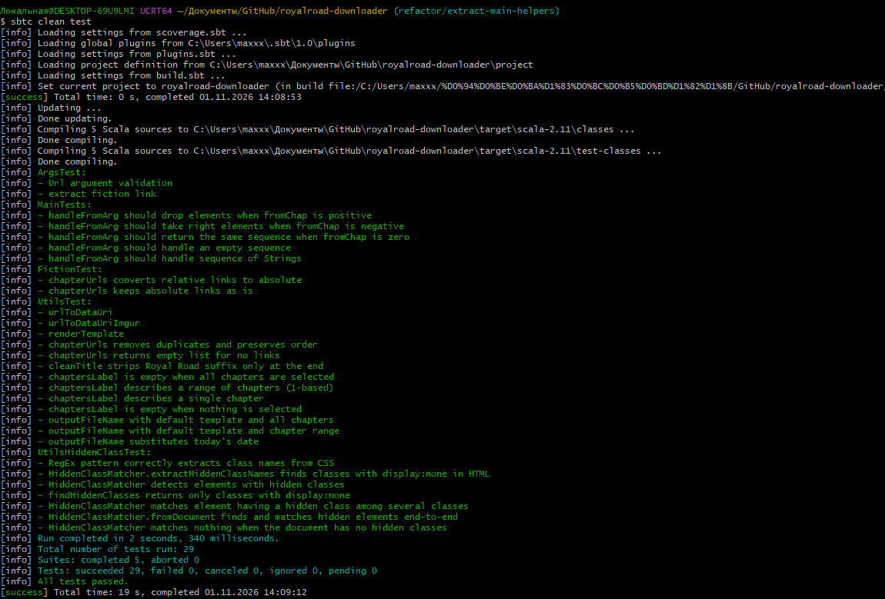
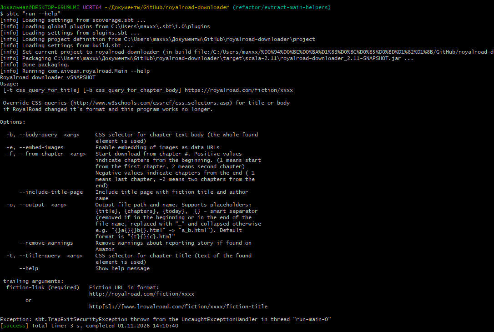
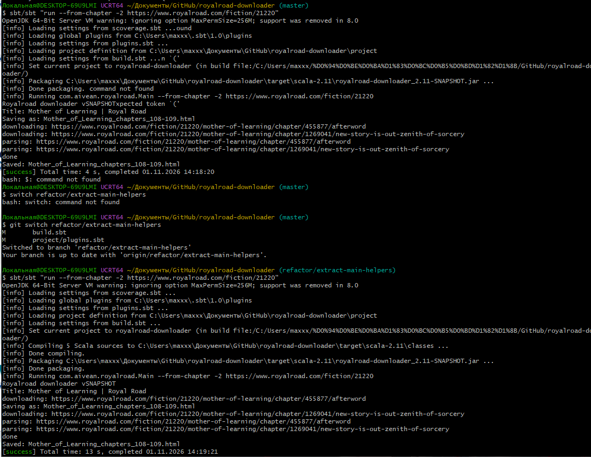
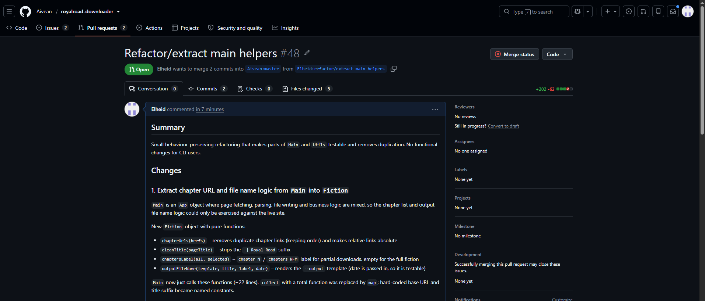

# Практика 103. Рефакторинг

**Студент:** Комаров Максим Сергеевич (GitHub: [Elheid](https://github.com/Elheid))

## 1. Выбранный проект

- **Репозиторий:** https://github.com/Aivean/royalroad-downloader
- **Fork:** https://github.com/Elheid/royalroad-downloader
- **Описание:** консольная утилита для скачивания произведений с сайта Royal Road в один HTML-файл.
  Умеет скачивать диапазон глав, встраивать изображения и удалять скрытые «предупреждения о краже»
  из текста.
- **Стек технологий:** Scala 2.11.11, sbt 1.1.6, scala-scraper 1.2.1 (jsoup), Scallop,
  ScalaTest 3.0.5, JDK 8.

**Локальное окружение** (подробно описано в отчёте по практике 102): Windows + MSYS2, Temurin JDK 8.
sbt работает только с Maven Central, потому что `repo.scala-sbt.org` недоступен из моей сети, поэтому
плагин `sbt-assembly` локально отключён. Эти правки не коммитились и в PR не входят. Работоспособность
программы проверялась через `sbt run`.

## 2. Что было сделано

- **Разделение Main** Чистая логика выносится из общего объекта `Main`
  в отдельный объект `Fiction`.
- **Разделение вычислений и ввода-вывода** Функции без побочных эффектов
  можно тестировать без сети. Дата передаётся параметром, а не берётся внутри функции.
- **DRY** Три скопированных прохода регулярного выражения заменены одной функцией.
- **Использование API библиотеки** (`classNames()` из jsoup) вместо ручного разбора строк.
- **Чистка** удаление мёртвого кода (неиспользуемые импорты), именование аргументов для читаемости вызова.

## 3. Выполненный рефакторинг

### Коммит 1. 

**Обнаруженные проблемы:**
- `Main` — это объект, который занимается очень многими вещами: pагрузка страниц, разбор HTML, запись файла и бизнес-логика.
  Всё это смешаны в одном месте, которое выполняется при запуске программы. Логику формирования списка глав
  и имени выходного файла нельзя было протестировать без реального сайта.
- Имя файла вычислялось вложенным блоком прямо внутри литерала `Map(...)` с ручной арифметикой
  индексов (`+ 1` в трёх местах).
- Использовался `collect` с полной функцией (оба `case` покрывают все варианты), хотя по смыслу здесь `map`.
- Базовый URL `"https://www.royalroad.com"` и суффикс заголовка `" | Royal Road"` были записаны прямо в код.

**Что сделано:** создан объект `Fiction` (`Fiction.scala`):
- `chapterUrls(hrefs)` — удаление дубликатов ссылок на главы (с сохранением порядка) и перевод
  относительных ссылок в абсолютные;
- `cleanTitle(pageTitle)` — удаление суффикса сайта из заголовка;
- `chaptersLabel(all, selected)` — метка диапазона `chapter_N` / `chapters_N-M`, пустая для всей книги;
- `outputFileName(template, title, label, date)` — подстановка шаблона из опции `--output`.

`Main` теперь только вызывает эти функции: 8 строк добавлено, 22 удалено. Поведение не изменилось.

```scala
// было
val filename = renderTemplate(cliArgs.output(), Map(
  "title" -> fileNameSafe(title.stripSuffix(" | Royal Road")),
  "chapters" -> {
    if (chapUrls.size != chapUrlsConstrained.size) {
      val firstChapter = chapUrls.indexOf(chapUrlsConstrained.head)
      ... // ещё 6 строк
  },
  "today" -> { new java.text.SimpleDateFormat("yyyy-MM-dd").format(new java.util.Date()) }
))

// стало
val filename = Fiction.outputFileName(
  template = cliArgs.output(),
  pageTitle = title,
  chaptersLabel = Fiction.chaptersLabel(chapUrls, chapUrlsConstrained),
  today = new java.util.Date()
)
```

**Тесты:** новый `FictionTest` (12 тестов): нормализация и дедупликация ссылок, очистка заголовка,
метки диапазона (все главы, `--from-chapter 3`, `--from-chapter -2`, одна глава, пустой выбор),
имя файла для шаблона по умолчанию, для диапазона глав и с подстановкой `{today}`.

### Коммит 2.

**Обнаруженные проблемы:**
- В `extractHiddenClassNames` трижды повторялся один и тот же код
  `cssPattern.findAllMatchIn(...).map(_.group(1)).toSet`, плюс лишние промежуточные переменные.
- В `matches` использовался `element.asInstanceOf[JsoupElement]`: элемент другого типа приводил
  к `ClassCastException`.
- Классы разбирались вручную (`attr("class").split("\\s+")`), хотя в jsoup есть `classNames()`.
- Неиспользуемые импорты (`JsoupElement` внутри метода, `org.jsoup.nodes.Element`) и полностью
  квалифицированные имена типов в сигнатурах (`net.ruippeixotog.scalascraper.model.Document`).

**Что сделано:**
- выделена функция `findHiddenClasses(css)`, которая применяется ко всем источникам текста
  (весь HTML, элементы `<style>`, текст `<head>`). Набор источников и результат прежние;
- `matches` переписан через pattern matching и `classNames()`. Для не-jsoup элементов возвращается
  `false` вместо исключения (в программе такие элементы не встречаются);
- импорты вынесены в начало файла, в сигнатурах используются короткие имена `Document`/`Element`.

```scala
// было
def matches(element: net.ruippeixotog.scalascraper.model.Element): Boolean = {
  import org.jsoup.nodes.Element
  val jsoupElement = element.asInstanceOf[...JsoupBrowser.JsoupElement]
  val classAttr = jsoupElement.underlying.attr("class")
  if (classAttr.isEmpty) false
  else classAttr.split("\\s+").toSet.exists(hiddenClassNames.contains)
}

// стало
def matches(element: Element): Boolean = element match {
  case e: JsoupElement => e.underlying.classNames().asScala.exists(hiddenClassNames.contains)
  case _ => false
}
```

**Тесты:** 4 новых теста в `UtilsHiddenClassTest`: `findHiddenClasses`; элемент с несколькими
классами, без класса и с пустым атрибутом `class`; сквозной сценарий `fromDocument` с поиском
скрытого `<span>` в главе; документ без скрытых классов. 3 старых теста проходят без изменений.

## 4. Проверка

- `sbtc clean test`: **29 тестов, 0 падений** (13 исходных + 16 новых) (скриншот 1);
- `sbtc "run --help"`: программа запускается (скриншот 2);
- ручная проверка на реальном сайте: при запуске с `--from-chapter -2` строки `Saved: …` и `Saving as: …`
  совпадают с именем выходного файла совпадает на `master` и на ветке рефакторинга (скриншот 3).






## 5. Pull Request

- Ветка: `refactor/extract-main-helpers`, 2 атомарных коммита:
  1. `Extract chapter URL and file name logic from Main into Fiction`
  2. `Simplify HiddenClassMatcher`
- PR в исходный репозиторий: TODO https://github.com/Aivean/royalroad-downloader/pull/48


